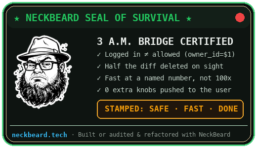

# neckbeard.tech

Official website and project badges for **[NeckBeard](https://github.com/openasocket/NeckBeard)** (`neckbeard.tech`).

  

  

## Contents

- [`index.html`](index.html) — Self-contained interactive website for `neckbeard.tech`
- [`CNAME`](CNAME) — Custom domain binding (`neckbeard.tech`)
- [`assets/site.css`](assets/site.css) & [`assets/site.js`](assets/site.js) — Zero-dependency styling and interactive code-matrix / crumbling-code / review / guard / band engines
- [`assets/badge.svg`](assets/badge.svg) & [`assets/badge.png`](assets/badge.png) — Compact README pill badge
- [`assets/seal.svg`](assets/seal.svg) & [`assets/seal.png`](assets/seal.png) — The "3 A.M. Bridge Certified" Seal of Survival
- [`assets/social-card.png`](assets/social-card.png) — 1280×640 OpenGraph card

## License

[MIT](LICENSE).
